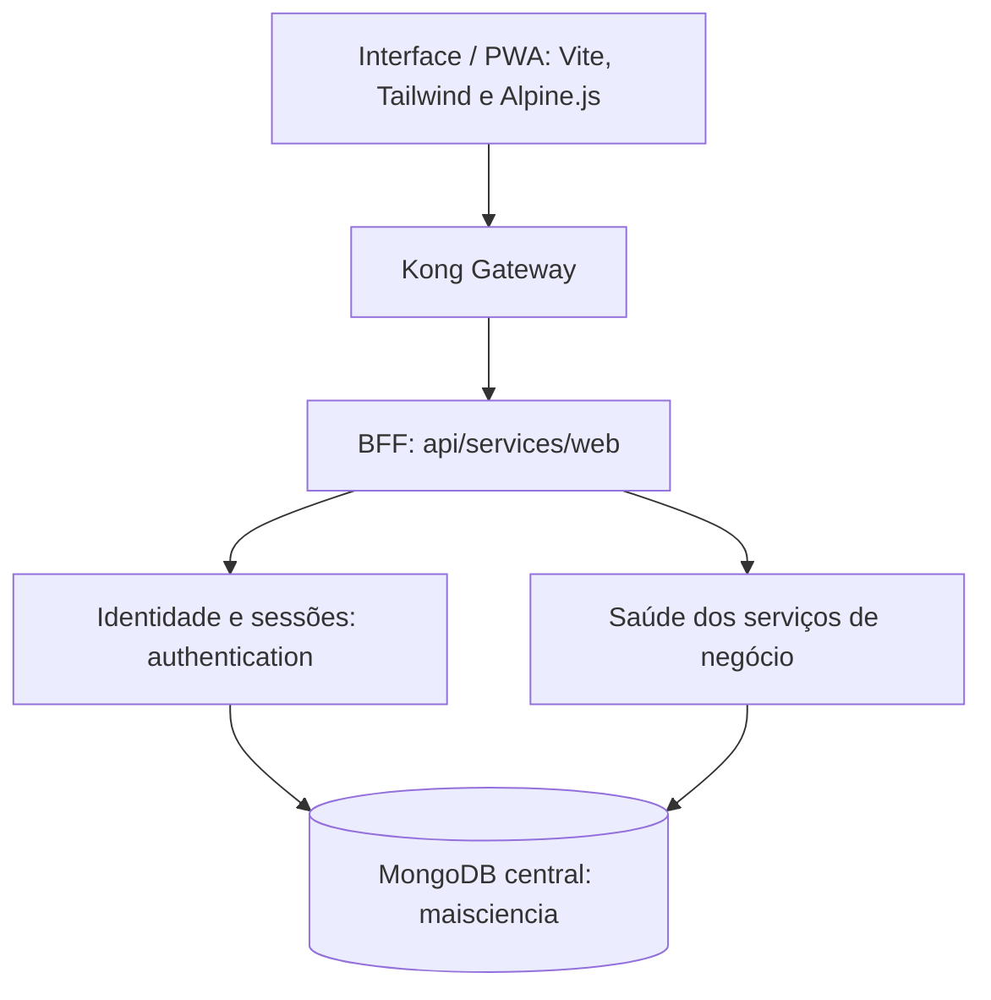

# Mais Ciência na Escola

Iniciativa de código aberto para um aplicativo do Programa Mais Ciência na Escola, destinado ao cadastro de escolas, estudantes, equipes, oficinas e práticas, acompanhamento das atividades, gerenciamento de eventos, publicações científicas, notícias e demais informações institucionais.

## Arquitetura



Cada serviço Flask possui aplicação, dependências, lockfile, ambiente virtual
e imagem próprios. Há oito serviços: sete APIs por domínio e o BFF em
`api/services/web`, dedicado ao frontend. O BFF consulta `authentication` para
gerenciar a sessão do navegador e agrega as verificações de saúde dos demais
serviços. Ele funciona sem cliente ou credenciais MongoDB.

A biblioteca `api/common` fornece a inicialização técnica dos sete serviços
com banco. O MongoDB mantém um único banco da aplicação, com usuários e
permissões específicos por domínio. A identidade e o estado das sessões
pertencem exclusivamente a `authentication`.

```text
web/                  Frontend Vite vanilla + Tailwind CSS + Alpine.js + PWA
api/common/           Biblioteca de inicialização Flask, MongoDB e healthchecks
api/services/         Sete APIs independentes por domínio
api/services/web/     BFF do frontend, com cookies e coordenação de sessões
api/gateway/          Rotas e CORS do Kong em modo DB-less
api/mongo/            Criação inicial das coleções e permissões
api/compose.yaml      MongoDB, Kong e serviços Flask
api/tests/            Testes dos contratos e do isolamento das aplicações
```

A base implementa infraestrutura, verificações de saúde, login, consulta,
renovação e encerramento de sessões. As regras de negócio, mensagens e
integrações com provedores serão desenvolvidas nos serviços correspondentes.
Novos endpoints de negócio deverão validar a sessão e aplicar suas permissões.

## Desenvolvimento orientado por especificações

A arquitetura segue SDD com GitHub Spec Kit. A
[constituição](.specify/memory/constitution.md) registra os princípios e o
[guia do fluxo](docs/spec-driven-development.md) explica como manter intenção,
plano, tarefas, contratos e evidências. Consulte o
[contexto arquitetural](docs/architecture.md) e as baselines em `specs/` antes
de alterar comportamentos. As baselines são retrospectivas e registram as
validações ainda pendentes.

```bash
bash scripts/specify.sh bootstrap
bash scripts/specify.sh version
python3 scripts/validate-specs.py
```

Os novos nomes dos domínios e coleções estão em
[005-domain-names](specs/005-domain-names/spec.md). Para volumes existentes,
consulte a migração em [api/README.md](api/README.md) antes de iniciar os serviços.

## Desenvolvimento local

Requisitos para o backend em containers: Docker com Compose 2.24 ou superior
e acesso ao daemon. Para o web: Node.js 24+ e npm. O desenvolvimento Python
direto também requer Python 3.11+ e Poetry 2.2+.

Em um terminal, inicie o backend:

```bash
cd api
docker compose up -d --build
docker compose ps
curl http://localhost:8000/api/administrations/health
curl http://localhost:8000/api/administrations/health/db
curl http://localhost:8000/api/web/health
curl http://localhost:8000/api/web/status
```

Os arquivos `.env` locais estão configurados nesta cópia de trabalho e são
ignorados pelo Git. Em uma nova clonagem ou outro ambiente, crie `api/.env`
conforme a seção de configuração em [api/README.md](api/README.md). Defina as
senhas antes da primeira inicialização do volume MongoDB.
O gateway fica em `http://localhost:8000`; as APIs são acessadas pelos seus
prefixos `/api/<service>`. A Admin API do Kong fica desativada.

O Compose inicia dez containers: oito serviços Flask, Kong e MongoDB.
Para preparar os índices e criar uma conta inicial, na pasta `api`, execute:

```bash
docker compose exec authentication .venv/bin/flask --app app init-db
docker compose exec authentication .venv/bin/flask --app app create-user --email user@example.org --name "Example User"
```

A senha é solicitada de forma oculta, com confirmação e mínimo de 12
caracteres. A criação de contas ocorre pela ferramenta administrativa.
Os comandos preservam os dados do volume; índices únicos exigem resolver
eventuais endereços de e-mail duplicados já existentes.

Em outro terminal:

```bash
cd web
npm ci
npm run dev
```

Abra `http://localhost:5173`. A página inicial apresenta o projeto, as oficinas,
as instituições, a equipe e o apoio institucional em português. Ela funciona
sem chamadas ao backend. `/login` apresenta uma mensagem provisória de acesso
ao futuro aplicativo, e `/feira` apresenta a página da feira em construção,
conforme [006-landing](specs/006-landing/spec.md).

## Integração e publicação da web

O workflow [Web](.github/workflows/web.yml) valida pull requests para `main` e
publica somente a web no GitHub Pages após sucesso em `main`. Executa instalação
pelo lockfile, ESLint, testes, validação SDD, build e conferência do artefato.
Uma execução manual em `main` também pode publicar.

Para ativar a hospedagem, selecione **GitHub Actions** em **Settings → Pages**
e incorpore o workflow pelo fluxo normal de revisão. Sem domínio personalizado,
o endereço esperado é `https://ifesguarapari.github.io/maisciencia/`. A base
da publicação é obtida da configuração do Pages; os builds locais continuam
usando `/` por padrão. A geração de entradas HTML permite abrir `login/` e
`feira/` diretamente em hospedagem estática.

O roteiro está em [007-web-delivery](specs/007-web-delivery/quickstart.md).
O workflow da API e o deploy no futuro VPS Hostinger foram adiados por pedido
do usuário. Esta configuração local não comprova publicação no GitHub.

O Vite encaminha `/api` para o Kong na porta 8000 para os futuros fluxos do
aplicativo. Os contratos de sessão existentes pertencem aos backends.

O navegador recebe um cookie `HttpOnly`. O estado fica na coleção `sessions`
do MongoDB e expira por inatividade ou pelo prazo absoluto configurado.
Em produção, use HTTPS e `SESSION_COOKIE_SECURE=true`. A configuração local
usa `false` para permitir HTTP. Os identificadores de sessão são mantidos
fora de `localStorage`, das respostas JSON públicas e do cache PWA.

## Qualidade e commits

Na pasta `api`, instale o ambiente de ferramentas e os hooks:

```bash
poetry install --with dev
poetry run pre-commit install --config ../.pre-commit-config.yaml
poetry run python -m unittest discover -s tests -v
poetry run black --config pyproject.toml --check common/maisciencia_common services tests
poetry run pylint --rcfile=pyproject.toml common/maisciencia_common services tests
```

Na etapa `pre-commit`, Black formata os arquivos Python de `api/` e Pylint
analisa o código em seguida. O hook `commit-msg` valida Conventional Commits
para o repositório. Prepare os arquivos com `git add` e
use `poetry run cz commit` em `api` ou `npm run commit` em `web`.
No web, execute `npm run lint` e `npm run build`.

Detalhes dos serviços, credenciais, coleções e execução independente em
[api/README.md](api/README.md). Configuração do frontend em
[web/README.md](web/README.md). Contrato do BFF em
[api/services/web/README.md](api/services/web/README.md).

Os padrões de idioma, formatação e configuração local estão definidos em
[CONTRIBUTING.md](CONTRIBUTING.md).
