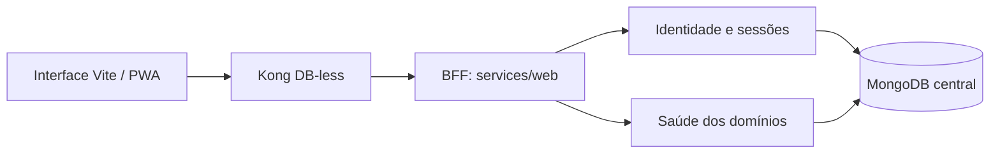

# Arquitetura permanente

**Captura inicial**: 2026-10-27. Este contexto acompanha a evolução das features.
O estado inicial é retrospectivo; a adoção de SDD não altera a origem do código.

## Visão geral

Oito serviços Flask são executados independentemente. Sete usam a biblioteca
`api/common` e mantêm clientes MongoDB próprios. O BFF em `api/services/web`
usa chamadas HTTP ao responsável pela autenticação e não recebe credenciais
de banco. O Compose declara os oito processos de serviço, Kong e MongoDB.

O diagrama descreve a infraestrutura de backend e a agregação de saúde
implementadas. A página pública de `006-landing` é uma apresentação estática
e não chama essas APIs. Os futuros fluxos de negócio precisarão de contratos,
validação de sessão e permissões próprias antes de expor dados.

## Limites e responsabilidades

| Diretório | Identidade HTTP | Responsabilidade de dados |
| --- | --- | --- |
| `api/services/administrations` | `administrations` | `schools`, `students`, `teams`, `memberships` |
| `api/services/activities` | `activities` | `workshops`, `practices`, `records` |
| `api/services/events` | `events` | `events`, `registrations`, `attendances` |
| `api/services/content` | `content` | `publications`, `news`, `informations` |
| `api/services/authentication` | `authentication` | `users`, `sessions`, `recoveries` |
| `api/services/messaging` | `messaging` | `conversations`, `messages`, `notifications` |
| `api/services/integrations` | `integrations` | `pipelines`, `agents` |
| `api/services/web` | `web` | Nenhuma coleção; identidade e sessão são delegadas. |

Os seis domínios de negócio têm configuração e saúde, sem CRUD ou regras
educacionais implementadas. Mensagens, chamadas de IA e recuperação de conta
também são escopos futuros. Coleções reservadas não equivalem a funcionalidades.

A identidade `administrations` é compartilhada pelo diretório, serviço, prefixo
HTTP e usuário MongoDB. A evolução nominal foi solicitada após a captura
inicial e está registrada em `005-domain-names`. Ambientes com dados e
credenciais anteriores exigem migração explícita; alterar o inicializador não
transforma um volume existente.

## Encaminhamento e dados

`api/gateway/kong.yaml` publica `/api/<service>` com limites de prefixo.
Para `authentication`, somente saúde é pública; as rotas `/internal/*`
exigem ainda um segredo de serviço no backend. O gateway usa configuração
declarativa, Admin API desativada e CORS com origens explícitas.

O banco da aplicação é definido por `MONGO_DB`, inicialmente `maisciencia`.
Cada usuário recebe permissões somente nas coleções do seu domínio.
`api/mongo/init-services.js` prepara um volume vazio. Atualizações posteriores
de usuários, índices, permissões ou dados exigem migração; nenhum artefato
SDD deve recriar um volume como atalho para concluir uma verificação.

Os workers Gunicorn criam as aplicações depois do fork. Cada aplicação com
banco reutiliza seu próprio `MongoClient`, com limite de pool configurável.
A separação dos processos mantém a infraestrutura central de dados como
dependência compartilhada de capacidade e disponibilidade.

## Sessão e interface

O BFF coordena login, consulta, renovação e logout. A autenticação persiste
o verificador do token opaco, aplica prazos absoluto e de inatividade e
revoga a sessão. O navegador recebe o identificador em cookie `HttpOnly`;
o token CSRF pode ser usado pelo JavaScript nos cabeçalhos exigidos.

HTTPS e cookies seguros fazem parte da configuração de produção. O ambiente
local pode usar HTTP com configuração explícita. As operações mutáveis do
BFF verificam origem e JSON; logout e renovação exigem CSRF válido.
Respostas de sessão não são armazenadas no cache PWA.

`web/` usa HTML, Tailwind CSS e Alpine.js, com build Vite e PWA. A página
institucional em `/` e as páginas provisórias `/login` e `/feira` usam português
do Brasil, conforme o pedido específico de `006-landing`; a feira segue o
conteúdo institucional já autorizado. Essas páginas não enviam requisições de
API. Os botões rosa Feira no cabeçalho desktop, no menu móvel e junto a Conheça
Mais abrem `/feira`, que apresenta o título “Feira”, a mensagem de página em
construção e o retorno ao site. O servidor estático deve retornar `index.html`
no acesso direto a `/login` e `/feira`, inclusive com barra final. O build de
`007-web-delivery` fornece entradas HTML físicas para essas rotas, permitindo
hospedagem estática no GitHub Pages sem depender de fallback SPA. A demonstração
anterior dos fluxos de sessão e saúde foi substituída na
entrada pública; a baseline `003` preserva seu inventário retrospectivo.

A landing apresenta as seções, instituições e pessoas fornecidas, com filtros
e painéis locais. Dados complementares de `site.docx` não fornecidos não são
inventados. O BFF e a autenticação continuam disponíveis na infraestrutura
para o futuro aplicativo. Instalação e experiência offline dependem da
validação em navegador, além do build.

## Integração e hospedagem da web

`.github/workflows/web.yml` executa checks em PRs para `main` e em `main`.
Somente `main`, fora de PR, pode publicar `web/dist` no ambiente `github-pages`,
após validação. O job de deploy recebe as permissões de escrita e compartilha
uma fila sem interromper a publicação ativa. A API e o futuro VPS Hostinger
não têm workflow ou configuração de implantação nesta entrega.

O site suporta a raiz e o prefixo do Pages, com base de build `WEB_BASE_PATH`.
Links, recursos, rotas, manifesto e service worker respeitam a mesma base.
O endereço esperado sem domínio próprio é
`https://ifesguarapari.github.io/maisciencia/`; a configuração efetiva do Pages
fornece a base na publicação. A ativação e uma execução real no GitHub são
etapas externas, distintas dos checks locais descritos em
[007-web-delivery](../specs/007-web-delivery/verification.md).

## Contexto permanente e especificações

- [Constituição](../.specify/memory/constitution.md): princípios e restrições do projeto.
- [001-platform-foundation](../specs/001-platform-foundation/spec.md): processos, contratos de infraestrutura e dados.
- [002-web-sessions](../specs/002-web-sessions/spec.md): identidade, sessão e fronteira navegador/backend.
- [003-web-pwa](../specs/003-web-pwa/spec.md): interface, saúde agregada e PWA.
- [006-landing](../specs/006-landing/spec.md): apresentação pública, rede, equipe e acessos provisórios ao aplicativo e à feira.
- [007-web-delivery](../specs/007-web-delivery/spec.md): integração contínua e hospedagem estática da web no GitHub Pages.
- [CONTRIBUTING.md](../CONTRIBUTING.md): idioma, qualidade e configuração local.

As verificações e suas limitações pertencem às features. Inspeção de
configuração e testes com mocks não comprovam integração real com Kong e
MongoDB. Resultados devem registrar o que foi executado, sem transformar
pendências de infraestrutura ou funcionalidades futuras em tarefas concluídas.
