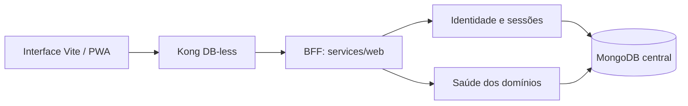

# Arquitetura permanente

**Captura inicial**: 2026-10-27. Este contexto acompanha a evolução das features.
O estado inicial é retrospectivo; a adoção de SDD não altera a origem do código.

## Visão geral

Oito serviços Flask são executados independentemente. Sete usam a biblioteca
`api/common` e mantêm clientes MongoDB próprios. O BFF em `api/services/web`
usa chamadas HTTP ao responsável pela autenticação e não recebe credenciais
de banco. O Compose declara os oito processos de serviço, Kong e MongoDB.

O diagrama descreve a infraestrutura de backend e a agregação de saúde
implementadas. A página pública de `006-landing` é uma apresentação estática
e não chama essas APIs. Os futuros fluxos de negócio precisarão de contratos,
validação de sessão e permissões próprias antes de expor dados.

## Limites e responsabilidades

| Diretório | Identidade HTTP | Responsabilidade de dados |
| --- | --- | --- |
| `api/services/administrations` | `administrations` | `schools`, `students`, `teams`, `memberships` |
| `api/services/activities` | `activities` | `workshops`, `practices`, `records` |
| `api/services/events` | `events` | `events`, `registrations`, `attendances` |
| `api/services/content` | `content` | `publications`, `news`, `informations` |
| `api/services/authentication` | `authentication` | `users`, `sessions`, `recoveries` |
| `api/services/messaging` | `messaging` | `conversations`, `messages`, `notifications` |
| `api/services/integrations` | `integrations` | `pipelines`, `agents` |
| `api/services/web` | `web` | Nenhuma coleção; identidade e sessão são delegadas. |

Os seis domínios de negócio têm configuração e saúde, sem CRUD ou regras
educacionais implementadas. Mensagens, chamadas de IA e recuperação de conta
também são escopos futuros. Coleções reservadas não equivalem a funcionalidades.

A identidade `administrations` é compartilhada pelo diretório, serviço, prefixo
HTTP e usuário MongoDB. A evolução nominal foi solicitada após a captura
inicial e está registrada em `005-domain-names`. Ambientes com dados e
credenciais anteriores exigem migração explícita; alterar o inicializador não
transforma um volume existente.

## Encaminhamento e dados

`api/gateway/kong.yaml` publica `/api/<service>` com limites de prefixo.
Para `authentication`, somente saúde é pública; as rotas `/internal/*`
exigem ainda um segredo de serviço no backend. O gateway usa configuração
declarativa, Admin API desativada e CORS com origens explícitas.

O banco da aplicação é definido por `MONGO_DB`, inicialmente `maisciencia`.
Cada usuário recebe permissões somente nas coleções do seu domínio.
`api/mongo/init-services.js` prepara um volume vazio. Atualizações posteriores
de usuários, índices, permissões ou dados exigem migração; nenhum artefato
SDD deve recriar um volume como atalho para concluir uma verificação.

Os workers Gunicorn criam as aplicações depois do fork. Cada aplicação com
banco reutiliza seu próprio `MongoClient`, com limite de pool configurável.
A separação dos processos mantém a infraestrutura central de dados como
dependência compartilhada de capacidade e disponibilidade.

## Sessão e interface

O BFF coordena login, consulta, renovação e logout. A autenticação persiste
o verificador do token opaco, aplica prazos absoluto e de inatividade e
revoga a sessão. O navegador recebe o identificador em cookie `HttpOnly`;
o token CSRF pode ser usado pelo JavaScript nos cabeçalhos exigidos.

HTTPS e cookies seguros fazem parte da configuração de produção. O ambiente
local pode usar HTTP com configuração explícita. As operações mutáveis do
BFF verificam origem e JSON; logout e renovação exigem CSRF válido.
Respostas de sessão não são armazenadas no cache PWA.

`web/` usa HTML, Tailwind CSS e Alpine.js, com build Vite e PWA. A página
institucional em `/`, a Feira, seu regulamento e as páginas provisórias
usam português do Brasil, conforme os pedidos específicos de `006-landing`
e `009-fair`. Essas páginas não enviam requisições de API. Os botões rosa
Feira no cabeçalho desktop, no menu móvel e no hero abrem `/feira`, que
apresenta a FEMAIS-ES e dá acesso à primeira edição e ao regulamento.
O hero contém somente Feira em rosa e Aplicativo em verde, sem Conheça Mais,
com o mesmo estilo dos equivalentes do cabeçalho: cantos de 6 px, borda e texto
coloridos e fundo na mesma cor com 10% de opacidade para Feira e 7% para
Aplicativo. Feira abre `/feira` e Aplicativo abre `/login`, respeitando a base
pública.
O item Oficinas nos dois menus e no rodapé abre `/oficinas`, com aviso de
construção e futura apresentação do planejamento e da execução das oficinas.
Os três cards têm selo “OFICINA”, sem número, e botões “Saiba mais” com cantos
de 6 px, borda e texto na cor da oficina e fundo na mesma cor com 10% de
opacidade, seguindo o estilo de Feira e Aplicativo. Eles abrem as páginas
correspondentes de ler, lançar e melhorar. “Voltar ao Início”, no encerramento,
segue o mesmo estilo na cor menta; esses controles mantêm foco visível.
Os links externos e a legenda Ambiente virtual foram substituídos.

`web/src/pages.js` centraliza o catálogo de páginas: Feira, regulamento e dezembro
com conteúdo, sete apresentações provisórias e a entrada inicial. A interface,
o plugin de rotas estáticas e o verificador de build compartilham as onze
entradas HTML. `007-web-delivery` fornece `<route>/index.html`, incluindo
rotas aninhadas. Isso permite acesso direto, recarga e barra final na raiz
ou no prefixo do GitHub Pages, sem depender de fallback SPA. A baseline `003`
preserva o inventário retrospectivo da demonstração de sessões e saúde.

`008-seo` centraliza identidade e metadados em `web/src/seo.js`. O build entrega
título, descrição, canonical HTTPS e política própria por rota; o cliente
mantém a coerência quando o PWA entrega o shell da inicial. Início, Feira,
regulamento e dezembro permitem indexação e entram no sitemap; somente a inicial
recebe JSON-LD `WebSite`. As sete provisórias usam `noindex,follow`. O build gera
`robots.txt` permissivo e `sitemap.xml`, combinando `WEB_SITE_ORIGIN` HTTPS
com `WEB_BASE_PATH`. A origem padrão é `https://maisciencia.ifes.app.br`;
origens alternativas não podem ter caminho, consulta, fragmento ou credenciais.
O [guia de SEO](seo.md) registra manutenção e etapas manuais de Search Console.
Esses sinais não comprovam indexação nem posição no Google.

[009-fair](../specs/009-fair/spec.md) rege `/feira`: identidade própria com
`images/feira/background.webp` e `images/feira/femais.svg`, paleta
azul-petróleo e botões amarelo,
azul e rosa translúcidos. O regulamento integral em `/feira/regulamento`
apresenta os textos ao final de `proposta.docx`; a Feira não publica orçamento
nem quantias monetárias. A primeira edição se divide em 04 de dezembro de
2026 (IFES Vila Velha), março de 2027 (IFES Piúma) e junho de 2027 (IFES Linhares).
A rota `/feira/202612` apresenta os cinco eixos e 20 atividades do documento
`202612.docx`, com uma ilustração SVG por subtítulo, descrições em detalhes
nativos, exposição, expositor e interatividade. A programação explicita
Ifes Vila Velha em 04/12/2026, data confirmada pelo usuário, com horários
14h30, 15h, 17h30 e 18h. O trecho
da Jornada de Integração usa `jic2026.png` e o site oficial, atribuindo
30/11–04/12/2026 e a participação aberta ao público somente à Jornada. A
FEMAIS mantém o público convidado das 13 instituições. As rotas
`/feira/202703` e `/feira/202706` permanecem em construção. A renderização compartilhada oferece conteúdo no HTML físico
e seleciona a mesma apresentação antes de Alpine quando o shell PWA é usado.
São páginas estáticas, sem inscrição, backend ou mudança de infraestrutura.

O cabeçalho da Feira usa Ifes e Mais Ciência; a logomarca da Feira aparece
ampliada no destaque principal. “Primeira edição”, “Feira expositiva” e
“Encontro” sem numeral são os rótulos editoriais vigentes. Os cards recebem
listas das instituições participantes, mantidas em `web/src/fair-data.js`,
com 13, 12 e cinco instituições nos encontros, respectivamente. A retirada
do aviso dos cards não define o estado dos destinos: dezembro oferece conteúdo,
enquanto março e junho permanecem provisórios e exibem “(A confirmar)”.
A apresentação destaca professores, alunos e pais do programa e a exposição
científica e tecnológica. A proposta gamificada incentiva interações com
expositores e acúmulo de pontos para troféus e premiações ao final, sem
implementar pontuação, regras ou serviços adicionais. O regulamento extraído
permanece integralmente preservado.

A landing apresenta as seções, instituições e pessoas fornecidas, com filtros
e painéis locais. Dados complementares de `site.docx` não fornecidos não são
inventados. O cabeçalho mantém as marcas Ifes e Mais Ciência. Somente o rodapé
usa a imagem original `web/public/images/popciencia.svg`, com proporção
preservada e o subtítulo “Programa Nacional de Popularização da Ciência”.
O cartão institucional `icons/slide.webp` mantém sua composição anterior.
As cinco rotas da Feira usam `icons/feira/slide.webp`, com fundo e marca
próprios da FEMAIS-ES e a marca Ifes, conforme 008. O HTML inicial e a
sincronização PWA mantêm Open Graph e Twitter coerentes com essa seleção.
O rodapé preserva missão, navegação, informações e Instagram e registra a
parceria em três linhas: “Desenvolvido em
parceria com:”, “Profe - Soluções em Tecnologia Educacional Ltda” e
“CNPJ: 66.907.525/0001-13”. As três linhas ficam no quadrante `.footer-identity`,
dentro do mesmo parágrafo da missão, após “Ciência, tecnologia e inovação
aproximando escolas e comunidades.”. O BFF e a autenticação continuam
disponíveis na infraestrutura para o futuro aplicativo. Instalação e
experiência offline dependem da validação em navegador, além do build.

## Integração e hospedagem da web

`.github/workflows/web.yml` executa checks em PRs para `main` e em `main`.
Somente `main`, fora de PR, pode publicar `web/dist` no ambiente `github-pages`,
após validação. O job de deploy recebe as permissões de escrita e compartilha
uma fila sem interromper a publicação ativa. A API e o futuro VPS Hostinger
não têm workflow ou configuração de implantação nesta entrega.

O site suporta a raiz e o prefixo do Pages, com base de build `WEB_BASE_PATH`.
Links, recursos, rotas, manifesto e service worker respeitam a mesma base.
Na consulta de configuração do Pages em 2026-11-07, o domínio é
`https://maisciencia.ifes.app.br/`, com HTTPS, base `/` e `build_type: workflow`.
A configuração efetiva fornece a base na publicação. Sem domínio próprio,
o endereço alternativo de projeto é `https://ifesguarapari.github.io/maisciencia/`,
com base `/maisciencia/`.

A autorização de 2026-11-07 permite executar Git Flow e publicar a web,
evoluindo a preparação local originalmente registrada em `007-web-delivery`.
A [política de versões](../CONTRIBUTING.md#versões-e-releases-da-web) adota
SemVer, versões independentes para web e API e tags sem prefixo. A release
`0.2.0` segue `bugfix/landing-details → develop → release/0.2.0 → main`, com
retorno a `develop`, changelog e publicação pelo workflow. As mudanças ficam
no [histórico de versões](../CHANGELOG.md); a execução remota e a conferência
do site devem ser registradas somente após sua realização em
[007-web-delivery](../specs/007-web-delivery/verification.md).

## Contexto permanente e especificações

- [Constituição](../.specify/memory/constitution.md): princípios e restrições do projeto.
- [001-platform-foundation](../specs/001-platform-foundation/spec.md): processos, contratos de infraestrutura e dados.
- [002-web-sessions](../specs/002-web-sessions/spec.md): identidade, sessão e fronteira navegador/backend.
- [003-web-pwa](../specs/003-web-pwa/spec.md): interface, saúde agregada e PWA.
- [006-landing](../specs/006-landing/spec.md): apresentação pública, rede, equipe e acessos ao aplicativo, à Feira e às oficinas.
- [007-web-delivery](../specs/007-web-delivery/spec.md): integração contínua e hospedagem estática da web no GitHub Pages.
- [008-seo](../specs/008-seo/spec.md): identidade no HTML inicial, canonical, indexação e manutenção de SEO.
- [009-fair](../specs/009-fair/spec.md): apresentação FEMAIS-ES, regras e etapas da primeira edição.
- [CONTRIBUTING.md](../CONTRIBUTING.md): idioma, qualidade e configuração local.

As verificações e suas limitações pertencem às features. Inspeção de
configuração e testes com mocks não comprovam integração real com Kong e
MongoDB. Resultados devem registrar o que foi executado, sem transformar
pendências de infraestrutura ou funcionalidades futuras em tarefas concluídas.

A release web 0.4.0 publicou a apresentação da FEMAIS-ES, regulamento e
etapas da Primeira edição no domínio existente, via Git Flow e GitHub
Actions. A API continua 0.1.0 e sem workflow de implantação. O registro da
publicação e da recriação local de `feature/issue/2` está nas evidências
de 007; a issue #2 permanece aberta para evoluções.

## Publicação web 0.5.0

Em 2026-11-18, a release web 0.5.0 publicou o encontro de 04/12/2026 no Ifes
Vila Velha por GitHub Actions, com build e deploy aprovados. A página de
dezembro passa a integrar as quatro URLs indexáveis, mantendo sete rotas
provisórias e onze entradas físicas. A API permanece em 0.1.0, sem workflow
ou implantação de VPS. As evidências estão em
[007-web-delivery](../specs/007-web-delivery/verification.md).
