# Modelo de dados e ciclo de vida

## Conta — coleção `users`

| Campo | Representação observada | Regra |
| --- | --- | --- |
| `_id` | Identificador MongoDB | Referenciado pela sessão; visão pública usa texto. |
| `email` | Texto normalizado | CLI remove espaços externos, aplica `casefold` e exige unicidade. |
| `name` | Texto | CLI exige valor não vazio. |
| `password_hash` | Texto com hash do Werkzeug | Nunca pertence à visão pública. |
| `active` | Booleano | Apenas `true` permite entrada e reutilização de sessão. |
| `created_at` | Data UTC | Criada pela ferramenta administrativa. |

## Sessão — coleção `sessions`

| Campo | Representação observada | Regra |
| --- | --- | --- |
| `_id` | Identificador MongoDB | Identidade estável durante a rotação. |
| `token_hash` | SHA-256 hexadecimal | Índice único; identifica o verificador do token opaco. |
| `csrf_token` | Texto aleatório | Prova estável vinculada à sessão e exposta à página autenticada. |
| `user_id` | Referência a `users._id` | A conta precisa continuar ativa. |
| `created_at` | Data UTC | Momento da criação. |
| `last_seen_at` | Data UTC | Atualizada com `$max` após validação. |
| `expires_at` | Data UTC | Prazo absoluto; índice TTL com `expireAfterSeconds=0`. |

O token privado não é um campo persistido. A aplicação interpreta timestamps
ingênuos do driver como UTC. A limpeza TTL não define a validade da sessão.

## Visão pública

`user: {id, email, name}`, `csrf_token` e `expires_at` são os únicos campos
da visão pública de sessão. Login e renovação privados também retornam
`session_token` ao BFF, que o transforma em cookie e o omite do JSON público.

## Transições

```mermaid
stateDiagram-v2
    [*] --> Active: Credenciais válidas
    Active --> Active: Consulta válida atualiza atividade
    Active --> Rotated: Renovação com CSRF válido
    Rotated --> Active: Novo identificador; anterior rejeitado
    Active --> Revoked: Saída confirmada
    Active --> Expired: Prazo absoluto ou inatividade
    Active --> Revoked: Conta desativada
    Revoked --> [*]
    Expired --> [*]
```

Estados do diagrama descrevem comportamento, não um campo `status` no banco.
Falhas do provedor resultam em indisponibilidade; o BFF não confirma revogação
nem remove o cookie quando não consegue confirmar a saída.
